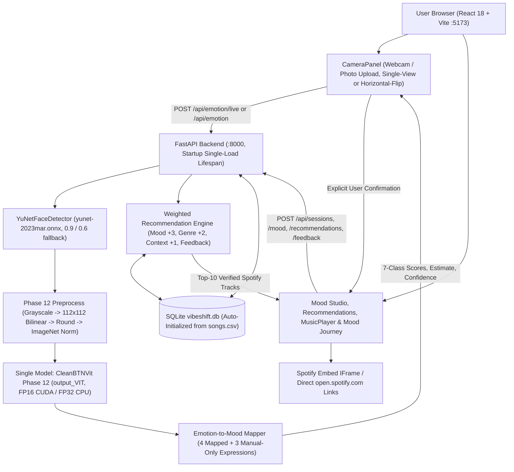

# VibeShift

### AI-Powered Mood-Based Music Recommendation System

**Feel It. Shift It. Play It.** — VibeShift is a full-stack adaptive music studio that pairs optional privacy-first facial-expression estimation (`YuNet` + standalone Phase 12 `CleanBTNVit`) with intentional **Match My Mood** or **Change My Mood** curation across English, Malayalam, Hindi, and Tamil catalogues, embedded Spotify playback, real-time feedback adaptation, and a chronological Mood Journey journal.

---

## 1. Project Overview

Most music platforms offer static playlists that ignore how a listener feels right now or where they want their emotional energy to go. VibeShift combines a human-in-the-loop emotional check-in (manual mood tiles or optional live webcam / photo estimation with explicit confirmation) with weighted multi-language recommendation scoring and session-level mood journaling.

## 2. Problem Statement

- Listeners rarely want purely automatic mood assumptions — facial expression is only a visual estimate, never proof of inner feelings.
- Existing multi-model AI prototypes suffer from high VRAM/latency overhead, unstable multi-face webcam tracking, and brittle training-workspace dependencies.
- VibeShift solves this by deploying **one single verified standalone facial-expression classifier (`CleanBTNVit — Phase 12`)** paired with **YuNet face detection** inside a portable, privacy-first FastAPI + React web application where the user always confirms or overrides their mood.

## 3. Key Features

- **Single-Model AI Emotion Estimation:** Real-time webcam scanning and single-photo upload using **YuNet** (`yunet-2023mar.onnx`) + **CleanBTNVit Phase 12** (`output_VIT`), loaded once at server startup.
- **Fast Default + Optional Accuracy Mode:** Defaults to **Single-View** inference (`22.53 ms` model-only / `45.61 ms` full server pipeline on RTX 3050 FP16) with an optional **Horizontal-Flip Accuracy Mode** (`42.63 ms` model-only / `69.25 ms` full server pipeline).
- **Privacy-First In-Memory Processing:** Camera frames and uploaded photos are processed strictly in RAM and never saved to disk.
- **Human-in-the-Loop Confirmation:** Unmapped expressions (`surprise`, `fear`, `disgust`) and low-confidence estimates never silently default to `neutral`; users always confirm or choose their mood manually.
- **Match My Mood vs. Change My Mood:** Stay with your current mood or transition intentionally toward a chosen target mood across 6 moods (`happy`, `sad`, `calm`, `energetic`, `angry`, `neutral`).
- **Multilingual Curated Catalogue:** 137 tracks across **English** (43), **Tamil** (40), **Hindi** (35), and **Malayalam** (19), with strict language filtering, 5 genres, and 6 activity contexts.
- **Spotify Embed Studio & Direct Links:** Central Spotify IFrame playback controller + direct `Open in Spotify` links.
- **Adaptive Feedback & Mood Journey:** `Like` (`+2`), `Replay` (`+1`), and `Skip` (`-2`) actions persist in SQLite and re-rank future recommendations; chronological session check-ins render in an interactive Recharts Mood Journey timeline.
- **Standalone Demo/Mock Mode:** Frontend also supports toggling between Live FastAPI Mode and offline Demo Mode.

---

## 4. Verified Technology Stack

| Layer | Technologies |
|---|---|
| **Frontend** | React 18 (`^18.3.1`), Vite 5 (`^5.4.11`), React Router 6, Framer Motion, Three.js / React Three Fiber (`@react-three/fiber`, `@react-three/drei`), Recharts, Lucide React |
| **Backend** | Python 3.10–3.12 (verified on `3.12.10`), FastAPI, Uvicorn, Pydantic v2, Pandas, `python-multipart`, `python-dotenv` |
| **AI & Computer Vision** | PyTorch (`2.10.0+cu126` GPU FP16 / CPU FP32 fallback), OpenCV (`opencv-python-headless` with `cv2.FaceDetectorYN` YuNet), NumPy |
| **Database** | SQLite 3 (auto-initialized schema + automatic 137-track seed from `backend/data/songs.csv`) |
| **Music Integration** | Official Spotify Embed IFrame API + direct `https://open.spotify.com/track/<id>` links |
| **Testing** | Pytest + FastAPI `TestClient` (backend), Vitest + React Testing Library + jsdom (frontend) |

---

## 5. System Architecture



---

## 6. Selected AI Model Details

- **Architecture:** **CleanBTNVit — Phase 12** (strictly batch-independent `output_VIT` pathway of `BatchTransformerNetwork` combining a frozen `MobileFaceNet` landmark branch, `IR-50` appearance backbone, 3-stage multi-scale landmark-guided cross-attention, and a 2-layer `VisionTransformer` + Squeeze-and-Excitation head at `112×112`).
- **Single Emotion Model Only:** No multi-model blending or ensembles.
- **Exact Preprocessing:** Detected face crop (`margin_ratio=0.06`) → luminance uint8 grayscale → float `[0, 1]` → `112×112` PyTorch bilinear interpolation (`align_corners=False`) → `.mul(255).round().div(255)` → 3-channel ImageNet normalization (`mean=[0.485, 0.456, 0.406]`, `std=[0.229, 0.224, 0.225]`).
- **Canonical 7-Class Ordering:** `0: angry`, `1: disgust`, `2: fear`, `3: happy`, `4: neutral`, `5: sad`, `6: surprise`.
  - Direct music-mood mappings: `happy`, `sad`, `angry`, `neutral` (still requiring user confirmation).
  - Manual-only expressions: `surprise`, `fear`, `disgust` (`emotion: null`).

## 7. Face Detection Using YuNet

VibeShift uses OpenCV's neural **YuNet** ONNX detector (`backend/ai/models/yunet-2023mar.onnx`, MIT-licensed) with thread-safe execution and two-stage score thresholding (`0.9` primary threshold with automatic `0.6` fallback). In live webcam mode, multi-face detection supports click-to-select targeting, IoU/proximity tracking, a `0.8 s` reacquisition window, and 2-frame EMA probability stabilization (`alpha = 0.5`).

## 8. Accuracy and Evaluation Disclosure

> **Important Disclosure:** The accuracy metrics below were measured on a **reused 4,015-image Training-derived FER-2013 development holdout** (`split.csv`) used across research phases — **not an independent held-out test set**. `PublicTest` and `PrivateTest` were strictly untouched during Phase 12 training.

| Mode | Reused 4,015-Image Holdout Accuracy | Macro F1 | NLL | ECE | Model-Only Latency (RTX 3050 FP16) | Full 640×480 Frame-to-Rec Latency |
|---|---:|---:|---:|---:|---:|---:|
| **Single-View (Default)** | **74.10%** (`2,975 / 4,015`) | 72.37% | 0.7467 | 0.0390 | **22.53 ms** median (`44.38 FPS`) | **45.61 ms** median |
| **Horizontal-Flip (Accuracy Mode)** | **74.37%** (`2,986 / 4,015`) | 72.78% | 0.7338 | 0.0314 | **42.63 ms** median (`23.46 FPS`) | **69.25 ms** median |

*CPU-only fallback is supported automatically when CUDA is unavailable; real-time throughput has only been benchmarked on an NVIDIA RTX 3050 Laptop GPU.*

---

## 9. Recommendation Algorithm

Weighted additive scoring (`backend/services/recommendation.py`):
- **Target Mood Resolution:** Matches `target_mood` when `mode="change"`, otherwise `current_mood`.
- **Strict Language Filter:** Excludes non-matching languages completely when a specific language is chosen (never silently backfilling other languages). Unfiltered `"All Supported"` mode interleaves languages within each score tier.
- **Scoring Weights:** Mood match **`+3`**, Genre match **`+2`**, Activity context match **`+1`**, Feedback modifiers **`+2`** (`like`), **`+1`** (`replay`), **`-2`** (`skip`). Tracks with non-positive scores are filtered out when an effective mood is set.

## 10. Spotify Integration

- All **137** catalogue tracks in `backend/data/songs.csv` have validated 22-character Spotify track URLs (`https://open.spotify.com/track/<id>`).
- `MusicPlayer` manages a single central Spotify Embed IFrame controller (`https://open.spotify.com/embed/track/<id>`) with automatic standard `<iframe>` fallback and a direct `Open in Spotify` external link.
- **Playback Scope:** Spotify Embeds do **not** provide unrestricted full-song streaming for unauthenticated users — Spotify plays 30-second previews unless the listener is logged into Spotify in their browser (or opens the track in the Spotify app).

---

## 11. Project Structure

```text
VibeShift-Final/
├── backend/
│   ├── ai/
│   │   ├── btn_runtime/          # Self-contained MIT-licensed CleanBTNVit architecture
│   │   ├── models/               # yunet-2023mar.onnx (included) + clean_btn_vit_phase12.pt (local setup)
│   │   ├── emotion_model.py      # Single-model CleanBTNVitAdapter & startup singleton
│   │   ├── face_detector.py      # Thread-safe YuNetFaceDetector
│   │   ├── live_pipeline.py      # Live webcam tracking & snapshot orchestration
│   │   └── preprocess.py         # Exact Phase 12 112x112 grayscale preprocessing
│   ├── api/                      # FastAPI routers (emotion, recommendations, sessions, feedback)
│   ├── data/songs.csv            # 137-track curated Spotify catalogue
│   ├── database/db.py            # Clean auto-initializing SQLite schema & CSV seeder
│   ├── schemas/                  # Pydantic v2 request/response schemas
│   ├── services/                 # Mood mapping & weighted recommendation engine
│   └── main.py                   # FastAPI app, startup lifespan, CORS, /api/health
├── frontend/
│   ├── public/favicon.svg
│   ├── src/                      # React pages, components, context, services, tests
│   ├── .env.example
│   ├── package.json
│   ├── package-lock.json
│   └── vite.config.js
├── scripts/
│   └── install_model.py          # Verified SHA-256 installer for authorized local/private checkpoint
├── tests/                        # Self-contained backend & AI integration tests
├── docs/
│   ├── API_CONTRACT.md
│   ├── ARCHITECTURE_AND_EVALUATION.md
│   ├── MODEL_SETUP.md
│   └── THIRD_PARTY_LICENSES.md
├── requirements.txt
├── requirements-dev.txt
├── .env.example
├── .gitignore
├── .gitattributes
├── setup.bat
├── run_backend.bat
└── run_frontend.bat
```

---

## 12. Prerequisites

- **Windows 10/11** (portable across Linux/macOS via standard Python venv + npm commands)
- **Python 3.10–3.12** (`python --version`)
- **Node.js 18+** & **npm** (`node -v`, `npm -v`)
- **Optional (Recommended for real-time camera AI):** NVIDIA CUDA-capable GPU (CUDA 12.6)

## 13. Installation Instructions

### Windows One-Click Setup
```cmd
:: Standard install (CPU PyTorch by default):
setup.bat

:: Optional NVIDIA CUDA 12.6 GPU install:
set VIBESHIFT_INSTALL_CUDA=1
setup.bat
```

### Manual Portable Setup (PowerShell)
```powershell
py -3.12 -m venv .venv
.\.venv\Scripts\python.exe -m pip install --upgrade pip

# Option A — NVIDIA CUDA 12.6 GPU (recommended):
.\.venv\Scripts\python.exe -m pip install torch==2.10.0+cu126 --index-url https://download.pytorch.org/whl/cu126
.\.venv\Scripts\python.exe -m pip install -r requirements.txt

# Option B — CPU fallback:
# .\.venv\Scripts\python.exe -m pip install -r requirements.txt

# Frontend dependencies:
cd frontend
npm ci
```

## 14. Model Asset Setup and Licensing

- `backend/ai/models/yunet-2023mar.onnx` (**MIT License**) is included in this repository.
- **`backend/ai/models/clean_btn_vit_phase12.pt` (~245.3 MiB, SHA-256 `0316ea2a96e671f562a770ace64b8665e8bc1996be0046cbe94c4674bb0c5d58`) is NOT hosted publicly in this repository** because public redistribution rights remain unestablished across its upstream academic dataset/checkpoint lineage (**AffectNet** non-commercial academic EULA, **ExpW** academic/non-commercial research terms, **RAF-DB** derived-data non-commercial restriction, and **MS-Celeb-1M** retracted backbone).
- **For authorized academic collaborators:** obtain `clean_btn_vit_phase12.pt` via your private team transfer (USB or restricted university cloud share) and install + SHA-256 verify it in one command:
  ```powershell
  # Either during setup:
  $env:VIBESHIFT_MODEL_PATH = "C:\path\to\clean_btn_vit_phase12.pt"
  .\setup.bat

  # Or anytime after setup:
  .\.venv\Scripts\python.exe scripts\install_model.py --from-file "C:\path\to\clean_btn_vit_phase12.pt"
  ```
- Without the weights file, VibeShift still launches cleanly in Manual Mood Mode (full manual mood selection, recommendations, Spotify embeds, feedback, and Mood Journey).
- Full legal breakdown, collaborator transfer guidance, and checksum verification steps are documented in [docs/MODEL_SETUP.md](docs/MODEL_SETUP.md).

## 15. Launching Frontend and Backend

**Windows Batch Launchers:**
1. Run `run_backend.bat` → FastAPI starts on `http://127.0.0.1:8000` (initializes a fresh SQLite DB and loads YuNet + CleanBTNVit once at startup).
2. Run `run_frontend.bat` → Vite dev server starts on `http://localhost:5173`.

**Manual Terminal Launch:**
```powershell
# Terminal 1 (from repo root)
.\.venv\Scripts\python.exe -B -m uvicorn backend.main:app --host 127.0.0.1 --port 8000

# Terminal 2
cd frontend
npm run dev
```

## 16. Environment Configuration

Copy `.env.example` → `.env` (backend) and `frontend/.env.example` → `frontend/.env` (frontend) as needed:
- `VIBESHIFT_BTN_WEIGHTS`: Path to `clean_btn_vit_phase12.pt`
- `VIBESHIFT_YUNET_MODEL`: Path to `yunet-2023mar.onnx`
- `VIBESHIFT_DEVICE`: `"cuda"` or `"cpu"` (auto-detected by default)
- `VIBESHIFT_DEFAULT_FLIP`: `"false"` (single-view default) or `"true"` (horizontal-flip accuracy mode)
- `VIBESHIFT_CORS_ORIGINS`: Comma-separated extra allowed frontend origins
- `VIBESHIFT_DB_PATH`: Custom SQLite database path (default: `backend/database/vibeshift.db`)
- `VITE_API_BASE_URL` / `VITE_API_MODE`: Frontend backend URL (`http://127.0.0.1:8000`) and mode (`live` or `mock`)

## 17. REST API Overview

| Method | Endpoint | Description |
|---|---|---|
| `GET` | `/api/health` | Server & AI model readiness |
| `GET` | `/api/emotion/model` | Active single-model CleanBTNVit metadata |
| `POST` | `/api/emotion` | Single-image emotion estimation (`<= 5 MB`, optional `horizontal_flip`) |
| `POST` | `/api/emotion/live` | Live webcam tracking or snapshot upload (`horizontal_flip`, `debug`) |
| `POST` | `/api/sessions` | Create listening session |
| `POST` | `/api/sessions/{id}/mood` | Record confirmed mood (`manual`, `camera_suggested`, `recheck`) |
| `GET` | `/api/sessions/{id}/journey` | Fetch chronological session Mood Journey |
| `POST` | `/api/recommendations` | Fetch top-10 mood/preference-ranked Spotify songs |
| `POST` | `/api/feedback` | Record `like`, `skip`, or `replay` feedback |

See [docs/API_CONTRACT.md](docs/API_CONTRACT.md) for complete payloads and schemas.

## 18. Testing Instructions

```powershell
# Install test dependencies & run backend tests
.\.venv\Scripts\python.exe -m pip install -r requirements-dev.txt
.\.venv\Scripts\python.exe -m pytest tests/ -v

# Run frontend unit/integration tests & production build
cd frontend
npm test -- --run
npm run build
```

## 19. Known Limitations

1. **Separately Obtained Weights on Fresh Clone:** `clean_btn_vit_phase12.pt` is excluded from public Git redistribution due to academic dataset terms; see [docs/MODEL_SETUP.md](docs/MODEL_SETUP.md).
2. **Reused Development Holdout:** Reported `74.10%` / `74.37%` accuracy figures come from a reused 4,015-image FER-2013 development holdout, not an independent test set.
3. **Physical Webcam Verification:** Automated CI/headless verification used mocked MediaDevices tests and real face photo uploads; physical webcam verification on local hardware remains a user-side check.
4. **Partial Expression-to-Mood Mapping:** `surprise`, `fear`, and `disgust` intentionally require manual mood choice.
5. **Spotify Preview Limits:** Embedded playback defaults to 30-second previews unless authenticated with Spotify in the browser.
6. **Global Feedback Pool:** SQLite feedback scores currently aggregate across sessions unless scoped per session.

## 20. Dataset, Third-Party Acknowledgments, and Academic Restrictions

- **MIT-Licensed Included Assets:** `SeoulTech-HCIRLab/BTN` (CleanBTNVit model code) and Shiqi Yu's `YuNet` (`yunet-2023mar.onnx`).
- **Academic/Non-Commercial Upstream Research Datasets (Not Included):** FER-2013, CUHK MMLab **ExpW**, University of Denver **AffectNet**, and **RAF-DB** are subject to **non-commercial academic and scientific research restrictions**.
- See [docs/THIRD_PARTY_LICENSES.md](docs/THIRD_PARTY_LICENSES.md) and [docs/ARCHITECTURE_AND_EVALUATION.md](docs/ARCHITECTURE_AND_EVALUATION.md) for full details and citations.
